# 周流 WeekFlow

一个挂在桌面边缘的透明每周待办小组件。把三个月的大目标拆成十二周，把这一周过完；完成事情攒积分，积分可以换奖励，也可以去奖池里赌一次运气。

**当前版本：0.10.2** · [更新日志](CHANGELOG.md)

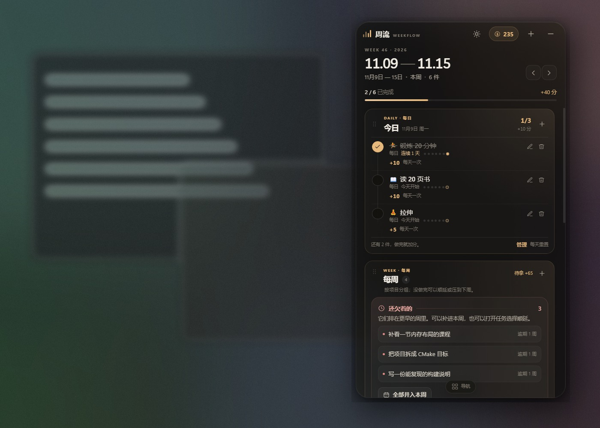

## 它是什么

- **透明、无边框、常驻桌面**：半透明毛玻璃面板，自动淡出，可收成一条只显示进度和下一件事的小条。
- **默认更简洁**：底部导航平时收起成一个小把手，需要时再展开；任务是一列纵向清单，不再挤成横排。每条周任务/每日任务右上角都有铅笔和垃圾桶，直接编辑或删除。
- **随时调外观**：顶栏太阳按钮打开快捷面板，滑杆直接调透明度，4 个主题（墨夜、苔林、暮紫、米白）一键切换。
- **长期目标 → 每周任务**：可以接 AI 自动拆解（Ollama、LM Studio、DeepSeek、OpenAI 等任意 OpenAI 兼容接口），也可以完全手动按周排计划。
- **手动规划**：不需要模型，给 8/12 周各写主题和任务，一行一件，支持 `任务 | 25` 指定积分。
- **每日任务**：锻炼、阅读、拉伸等每天固定出现，不用安排到某一周；每天完成一次加分，自动重置，显示连续天数。
- **待办**：不排周次、没有截止时间的高积分任务；想做了随时打勾，支持自定义、编辑、删除和撤销完成。
- **每周重复**：添加周任务时可勾选“每一周都要完成”，按项目剩余周生成任务。
- **周末/节假日双倍**：周六日或自定义节假日完成任务，积分 ×2；加成在完成时写入积分流水。
- **三个框可拖动**：每日、每周、待办可以按住左侧把手上下拖动，换成你习惯的顺序，顺序会记住。
- **单件任务推迟**：可以只顺延这一件，或只把它压到下周；不会牵动同项目其他任务。项目级顺延仍然保留在项目菜单里。
- **积分 → 奖励 → 兑换**：自己录入、编辑、删除奖励；兑换记录单独放在“兑换”页，显示兑换时间、核销时间与待使用状态，用掉时点“核销”。
- **奖池**：自己设结果、权重和积分，概率公开，大概率空手而归。
- **数据在本地**：一个 JSON 文件，无账号、无云同步；支持导出/导入和每日备份。

## 快速开始

1. 解压 `WeekFlow-0.10.2-win-x64-portable.zip` 到任意可写文件夹（不要直接在压缩包里运行）。
2. **双击 `START_WEEKFLOW.cmd`**，不要直接点 `WeekFlowApp.exe`。尤其是把文件夹放在 DSH 的 `default-workspace` 下时，Windows 会阻止其中的 GUI 程序直接启动；启动器会先把运行文件复制到 `%LOCALAPPDATA%\WeekFlow\runtime`，再从那里启动。首次会多等几秒。
3. 默认在屏幕右上角出现。可直接拖动顶部区域移动；右上角 `—` 收起成桌面小条。
4. 打开 `设置 → AI 规划`，填入你的模型接口，点“测试”：
   - Ollama：`http://127.0.0.1:11434/v1`，模型填 `ollama list` 里已有的名字，例如 `qwen2.5:7b`
   - LM Studio：`http://127.0.0.1:1234/v1`，模型可先填 `local-model`，点测试后会自动选
   - DeepSeek：`https://api.deepseek.com/v1`，模型 `deepseek-chat`，需要 API Key
5. 回到“本周”，点“AI 规划”，写下目标（例如“未来三个月从零学 C++，做出一个可玩的小引擎”），生成后检查每周安排，加入蓝图。
6. 不想用 AI 时，点“手动规划”：按周写主题和任务，一行一件；`写完练习 | 25` 可以把积分设成 25。
7. 每天固定要做的事，点本周顶部“每日”里的“锻炼 10 分”快速加入，或点 `+` 自定义；完成后第二天自动重置。
8. 想换透明度和主题，点顶栏太阳图标，拖动滑杆或点主题色块即可。
9. 底部中间的小“导航”把手用来展开/收起本周、蓝图、奖励、兑换、设置；选完页面会自动收起。

详细图文说明见 [docs/USER_GUIDE.md](docs/USER_GUIDE.md)。

## 截图

| 本周 + 每日任务 | 桌面小条 |
| --- | --- |
|  | 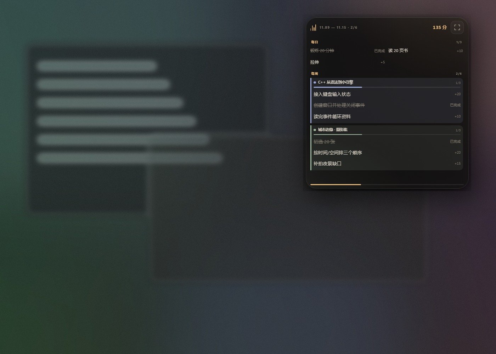 |

| 默认收起导航 | 需要时展开 |
| --- | --- |
|  | 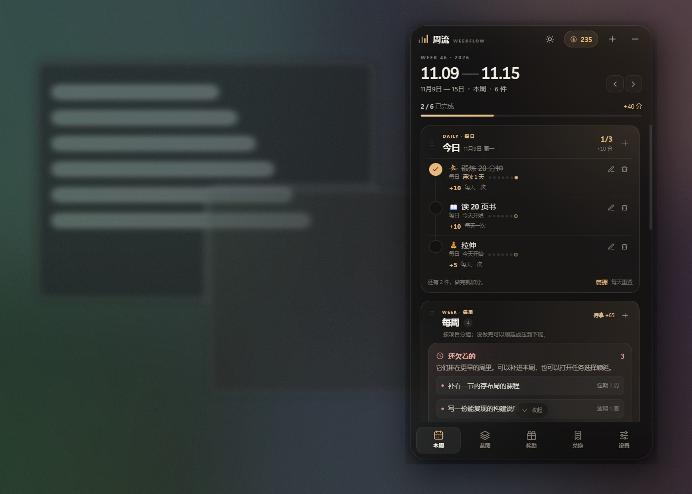 |

| 纵向任务清单 |
| --- |
| 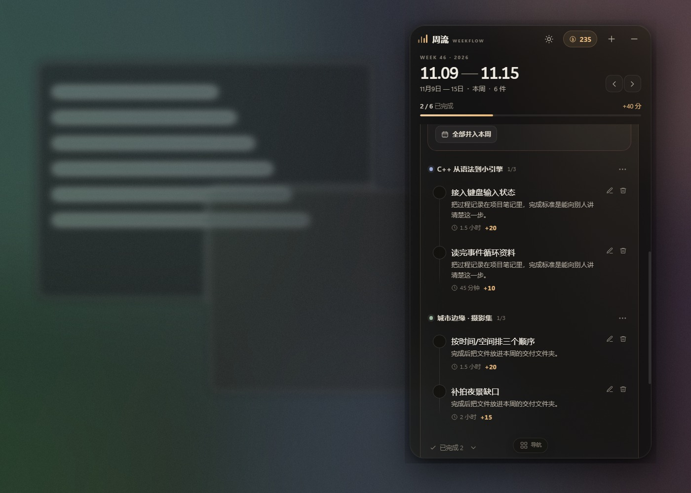 |

| 快捷透明度与主题 | 米白主题 |
| --- | --- |
| 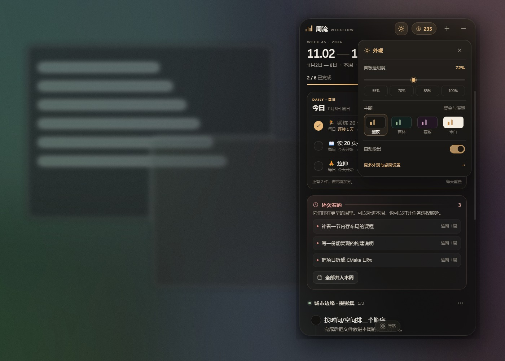 | 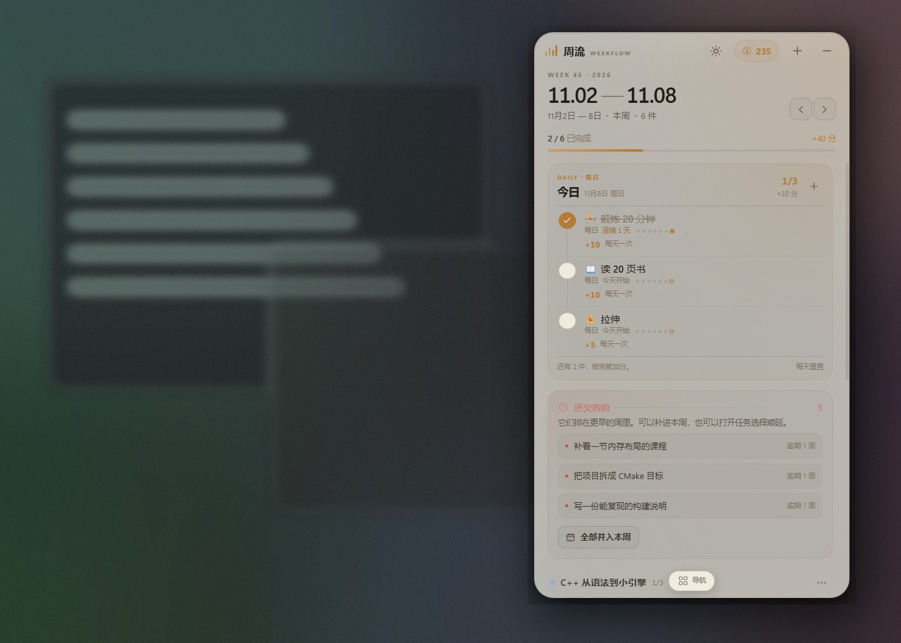 |

| AI 拆解 | 手动排周计划 |
| --- | --- |
| 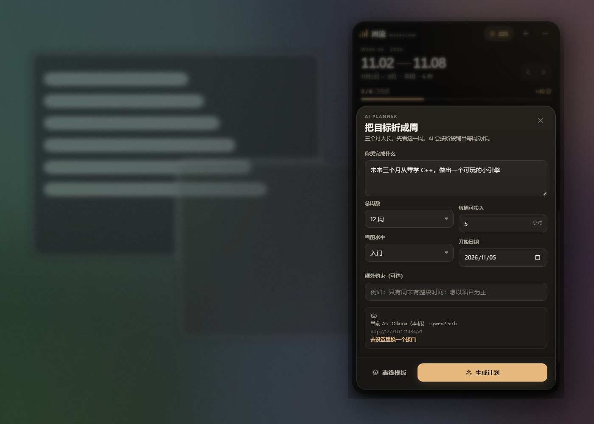 | 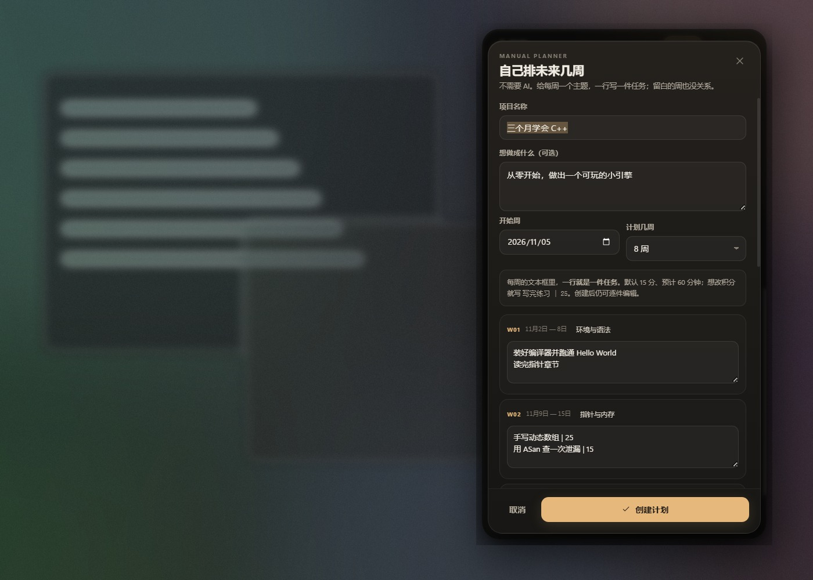 |

| 两种推迟 | 奖励与奖池 | 抽奖结果 |
| --- | --- | --- |
| 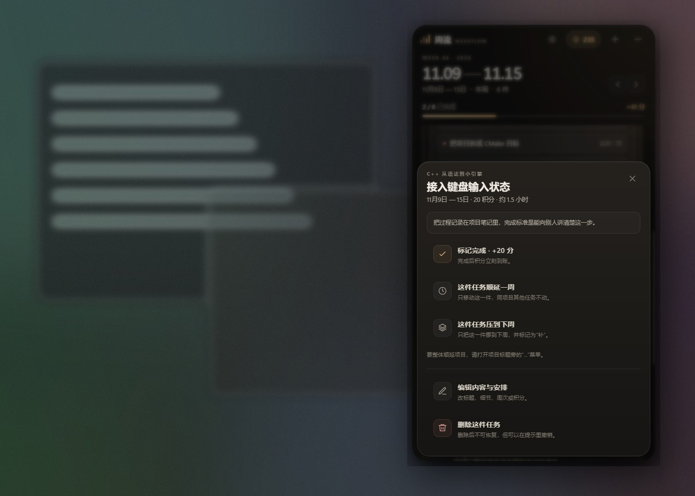 | 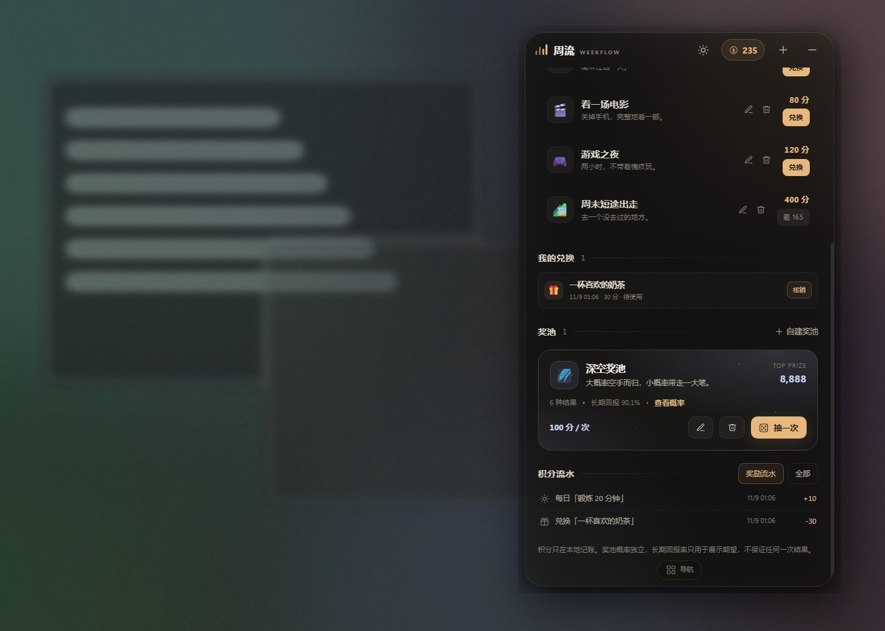 | 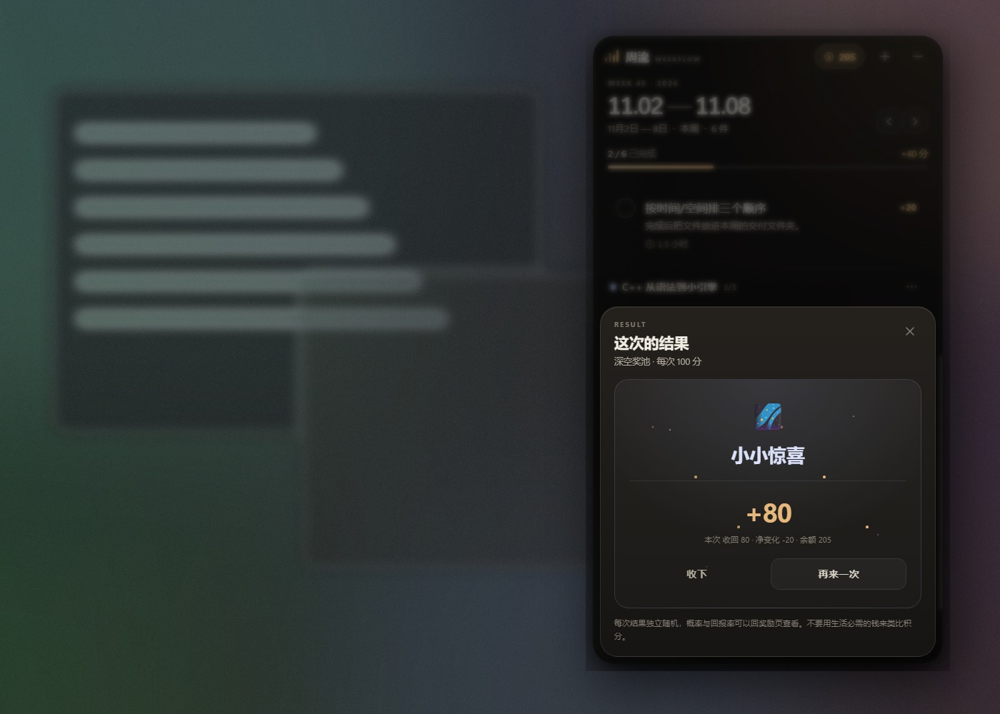 |

| 兑换记录 |
| --- |
| 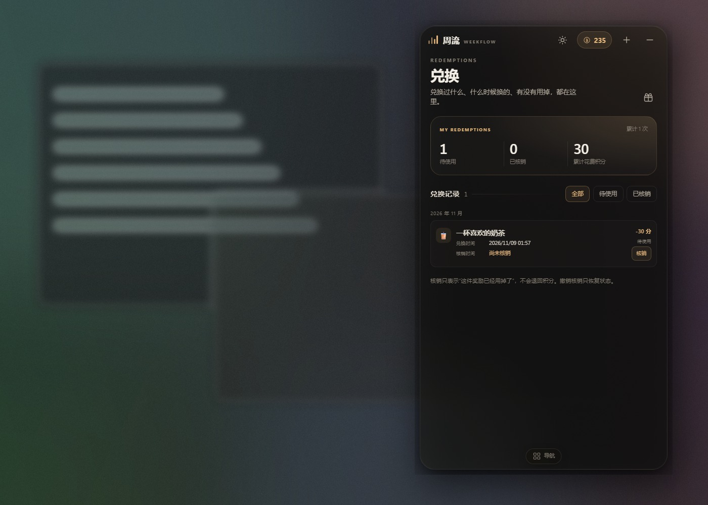 |

## 单件任务与项目推迟

打开具体任务 → 操作面板，默认只操作这一件：

- **这件任务顺延一周**：只把这一件后移 7 天，同项目其他任务不动。
- **这件任务压到下周**：只把这一件挪到下周，并标记“补”。

如果确实要调整整个项目，打开项目标题旁的 `...` 菜单，选“整体顺延一周”；那会移动该项目所有未完成任务。

所有推迟都有撤销提示；如果错过提示，可以再点任务选择相反操作，或直接编辑周次。

## 数据与可迁移性

- 便携版：数据保存在 `START_WEEKFLOW.cmd` 同级的 `data/` 文件夹；整个文件夹拷走即可换电脑。运行文件会复制到 `%LOCALAPPDATA%\WeekFlow\runtime`，与数据分开。
- 默认安装版（源码启动）：`%APPDATA%\WeekFlow`。
- `设置 → 数据` 可以导出/导入 JSON；每次保存前会写入 `data/backups/`，保留最近 21 天。
- 目标机器不需要 Node、Python 或编译环境；只需要 Windows 10/11 x64，以及可选的本机/远程 AI 服务。

## 从源码运行

```powershell
npm install
npm start
npm test
npm run dist
```

- Node.js 22+（本项目在 Node 24 下开发）。
- 打包使用 `@electron/packager`，产物在 `dist/WeekFlow-win32-x64`。
- 如果当前终端设置了 `ELECTRON_RUN_AS_NODE=1`，运行 Electron 前需要先移除该环境变量，否则 Electron 会以 Node 模式启动。

## 已知边界

- 只打包了 Windows x64；源码本身是跨平台的，但没有在 macOS/Linux 上做验收。
- 不要直接双击 `WeekFlowApp.exe`，也不要把整个文件夹放在 DSH 的 `default-workspace` 下直接运行 exe：该目录会阻止 GUI 程序启动。用 `START_WEEKFLOW.cmd`，或把文件夹移到 Desktop / Apps 等普通目录。
- 没有云同步、没有账号、没有自动更新。
- AI 计划质量取决于接入的模型；本机小模型可能给出泛泛的计划，建议用 7B 以上模型，并在预览里自行调整。
- 奖池使用 `Math.random`，是娱乐性的积分玩法，不是加密随机数，也不涉及真实货币。
- 集成显卡/远程桌面下透明窗口可能退化为不透明；可用设置里的“面板不透明度”调整。
- 没有系统通知和重复任务；每周一打开应用时会提示上周未完成项。

## 许可

MIT。第三方运行时（Electron）遵循其各自许可。
