# 周流 WeekFlow 使用说明

版本 0.12.0 · Windows x64 便携版

周流是一个挂在桌面边缘的透明每周待办。它不要求每天打卡，只处理三件事：这一周做什么、没做完怎么往后放、做完换什么奖励。

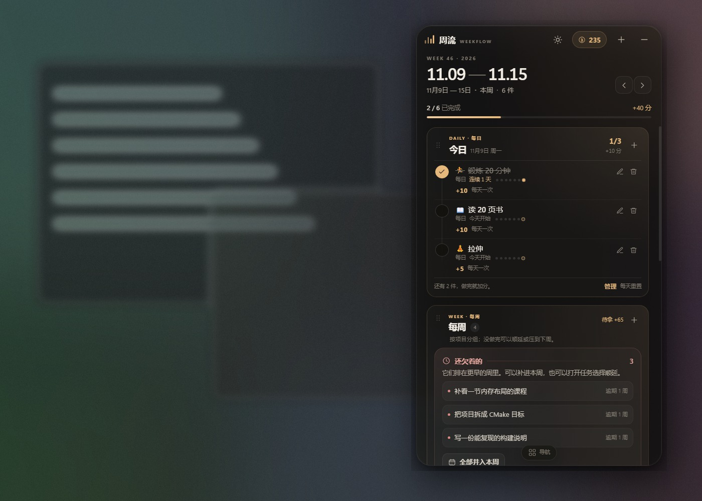

---

## 1. 启动与界面

### 1.1 启动

1. 将 `WeekFlow-0.12.0-win-x64-portable.zip` 解压到一个可写文件夹，例如 `D:\Apps\WeekFlow`。
2. **双击 `START_WEEKFLOW.cmd`**，不要直接双击 `WeekFlowApp.exe`。
3. 首次运行启动器会把运行文件复制到 `%LOCALAPPDATA%\WeekFlow\runtime`，通常几秒钟；SmartScreen 如弹出，点“更多信息 → 仍要运行”。
4. 不需要安装 Node.js、Python 或数据库；程序不会写注册表（开机启动除外）。

**为什么需要启动器？** 如果文件夹位于 DSH 的 `default-workspace` 下，Windows 会阻止其中的 GUI 程序直接启动，Electron 会在创建窗口前退出，看起来就是“双击没反应”。启动器用命令行复制到工作区外再启动，数据仍留在当前文件夹的 `data/`。

不要在压缩包内直接运行，也不要放进 `C:\Program Files` 这类只读目录。放到 Desktop、`D:\Apps` 等普通目录时，直接运行 `WeekFlowApp.exe` 也可以，但仍推荐启动器。

### 1.2 桌面行为

| 操作 | 方式 |
| --- | --- |
| 移动 | 按住顶部品牌栏或周标题区域拖动 |
| 隐藏/显示 | 单击托盘图标，或按设置页显示的快捷键 |
| 收起为小条 | 右上角 `—`；点小条右侧按钮展开 |
| 退出 | 托盘菜单 → 退出 |
| 鼠标穿透 | 托盘菜单或设置开启；按快捷键/托盘恢复 |
| 窗口置顶 | 设置里可关；默认置顶 |
| 自动淡出 | 默认关闭；可在设置里开启，鼠标移开变淡，移入恢复 |
| 切换页面 | 点底部中间的“导航”把手；选完页面自动收起 |
| 调透明度/主题 | 点顶栏太阳按钮，拖动滑杆或点主题色块 |

底部导航默认不显示，只留一个小把手，让任务区多出一行空间。点“导航”才会展开本周 / 蓝图 / 奖励 / 兑换 / 设置；点“收起”或选任一页面会重新收起。

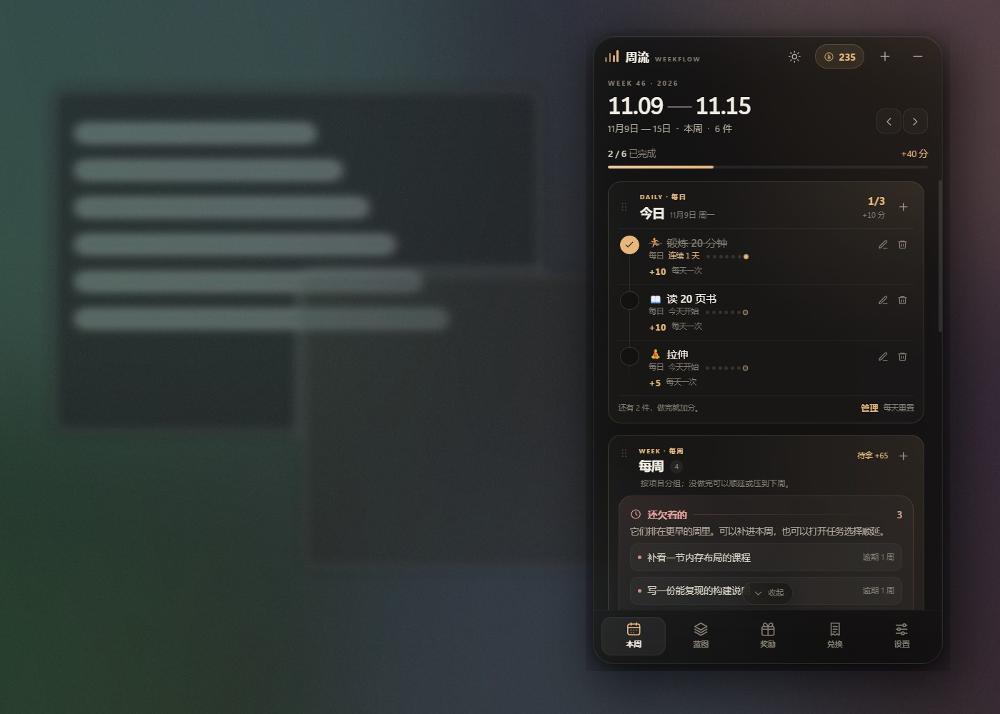

快捷键会依次尝试 `Alt+Shift+W`、`Ctrl+Shift+W`、`Ctrl+Alt+W`，以设置页实际显示为准。

**快捷外观面板**：太阳按钮会打开一个小浮层。滑杆默认 72%，从 45% 到 100% 实时生效；下方四个主题色块可以立即切换“墨夜 / 苔林 / 暮紫 / 米白”。换主题时会同时换一套匹配的强调色，之后仍可在设置里单独改强调色。

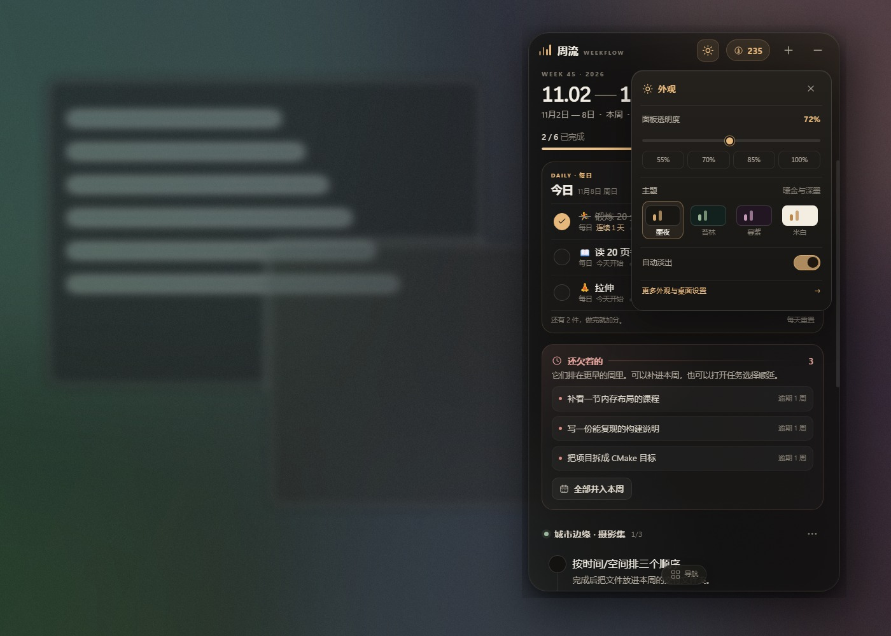

米白主题：

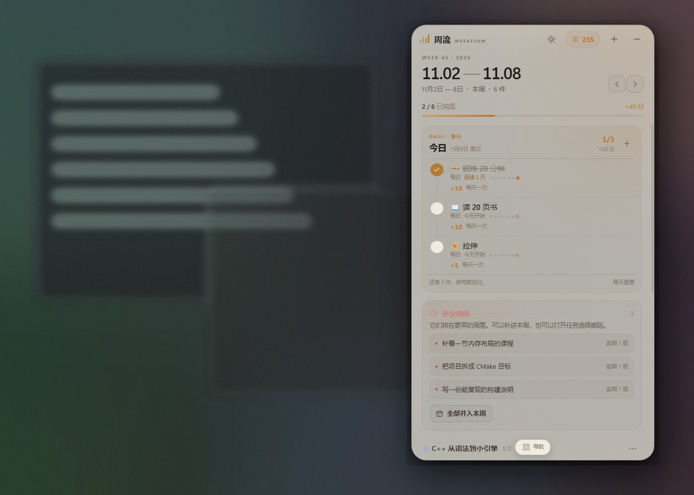

小条占 380×400，完整显示每日任务和按项目分组的每周任务，带项目色块、步骤进度和每周标记；内容多时在小条内滚动：

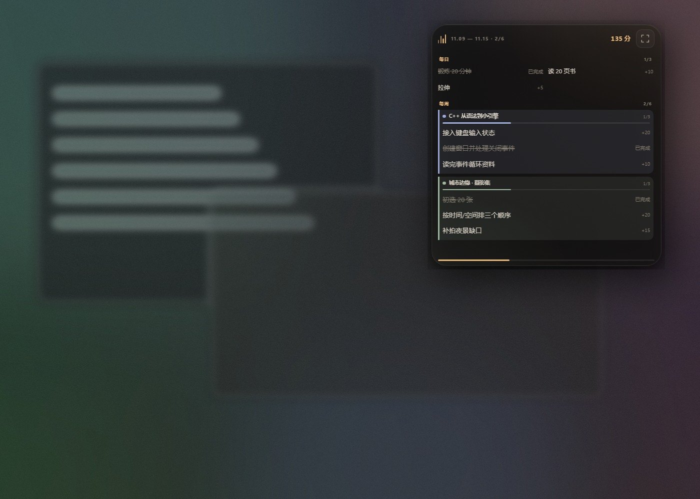

---

## 2. 第一次配置 AI

周流不内置模型，通过 **OpenAI 兼容接口** 调用你选择的模型。本机模型和远程 API 都行。

### 2.1 Ollama（本机、免费、不联网）

```powershell
ollama pull qwen2.5:7b
ollama serve
```

在 `设置 → AI 规划 → 配置 AI` 填写：

- 类型：Ollama（本机）
- 地址：`http://127.0.0.1:11434/v1`
- 模型：`qwen2.5:7b`（必须与 `ollama list` 里的名字一致）
- API Key：留空

点“测试”，出现“连接成功，发现 N 个模型”即可。

### 2.2 LM Studio（本机）

1. 在 LM Studio 加载模型，启动 Local Server（默认 1234 端口）。
2. 周流中选“LM Studio（本机）”，地址 `http://127.0.0.1:1234/v1`，模型先填 `local-model`。
3. 点“测试”，成功后会自动选择服务端返回的第一个模型。

### 2.3 DeepSeek / OpenAI / 其他网关

| 服务 | 地址 | 模型示例 | Key |
| --- | --- | --- | --- |
| DeepSeek | `https://api.deepseek.com/v1` | `deepseek-chat` | 需要 |
| OpenAI | `https://api.openai.com/v1` | `gpt-4o-mini` | 需要 |
| 自定义网关 | 以 `/v1` 结尾 | 以服务商为准 | 视情况 |

测试会先请求 `GET /models`；如果网关只提供 `/chat/completions`，会自动用一条最小对话测试。

**隐私**：配置保存在本机 `data/weekflow.json`，API Key 为明文。使用本机模型时目标文本不离开电脑；远程接口受服务商政策约束。

### 2.4 没有 AI 也能用

计划向导里有“离线模板”：只在起步、四分之一、中点、四分之三、收尾周放检查点，其余周留白。它不会编造 36 条重复任务，但也不是 AI 计划。

---

## 3. 创建 12 周计划

有两种方式：让 AI 拆，或自己一周一周排。两者都会生成同样的“项目 + 每周任务”。

### 3.1 让 AI 拆

以“未来三个月从零学 C++，做出一个可玩的小引擎”为例：

1. 本周页点“AI 规划”，或蓝图页点“拆解”。
2. 填写目标、总周数（3 个月选 12）、每周可投入小时数、当前水平、开始日期、额外约束。
3. 点“生成计划”。本机模型可能需要几十秒。
4. 检查预览：每周 2–4 个任务、有可验收产出、第一周做校准、最后一周留复盘。
5. 点“加入蓝图”。任务会按开始日期落到对应周的周一。

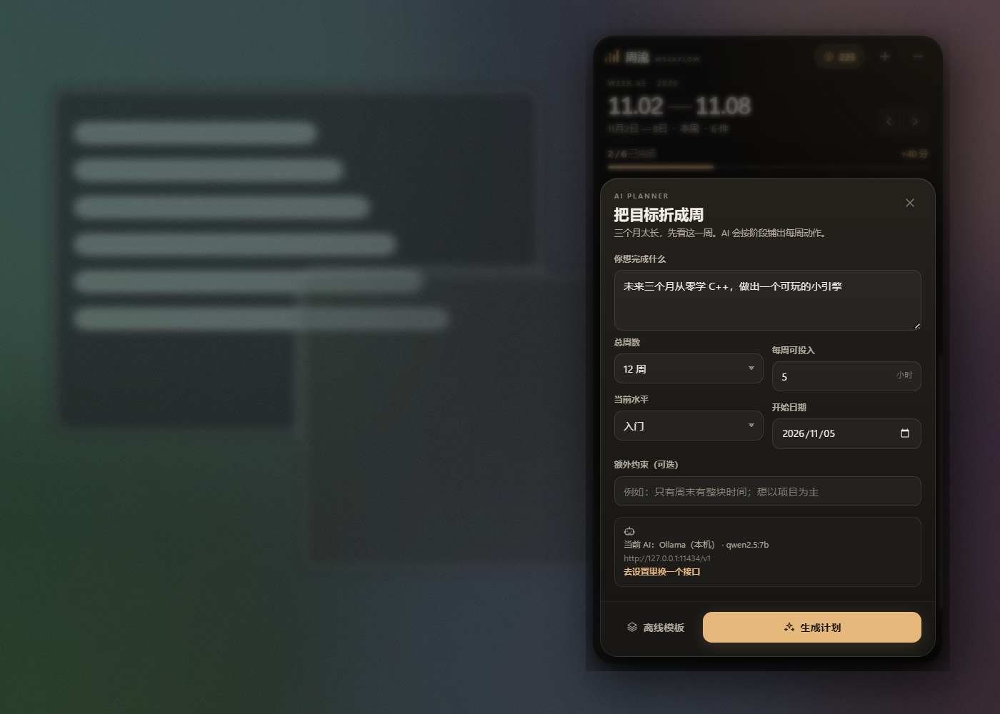

AI 只是初稿。加入后可以改标题、细节、周次、积分，或删除不合适的内容。

### 3.2 完全手动规划

蓝图页 → “手动规划未来几周”，或本周空状态里的“手动规划”；AI 计划弹层里也有“不接 AI，自己排周计划”。

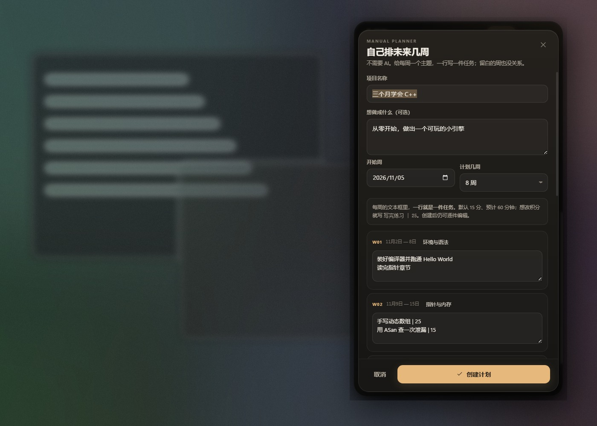

填写：

- 项目名称与目标（目标可空）。
- 开始周、计划几周（4–26 周）。
- 每周一个主题，下面的文本框**一行一件任务**。
- 默认每件 15 分、预计 60 分钟；写 `手写动态数组 | 25` 可以把这件的积分设为 25。
- 某一周可以完全留白；没有任何任务的周不会生成任务，但会保留在项目时间轴里。

点“创建计划”后，任务按周落到蓝图和本周视图。之后仍可逐件编辑标题、细节、积分、周次。

### 3.3 手动建空项目

蓝图页底部 → “只建一个空项目”，填写名称、目标、开始周、计划周数。之后添加任务时选择“归属项目”。适合先建项目、边做边加任务。

---

## 4. 每周操作

### 4.1 完成

- 点任务左侧圆圈：完成并加分，弹出“+N 分”。
- 点提示里的“撤销”可立即撤回；如果积分已花掉，撤销会被拒绝，避免负分。
- 点任务正文：查看完整细节、编辑、推迟、删除。
- 任务详情里的 `BV...` 号和链接会自动显示为复制按钮；点一下即可复制，不需要手动拖选。

任务按**单列纵向清单**排列：完成圆圈在左侧，标题、说明、时长/积分依次向下，多个任务由一条细线串起来，不再挤成横向表格。每条任务右上角有**铅笔（编辑）**和**垃圾桶（删除）**两个按钮，不需要先点开任务正文。

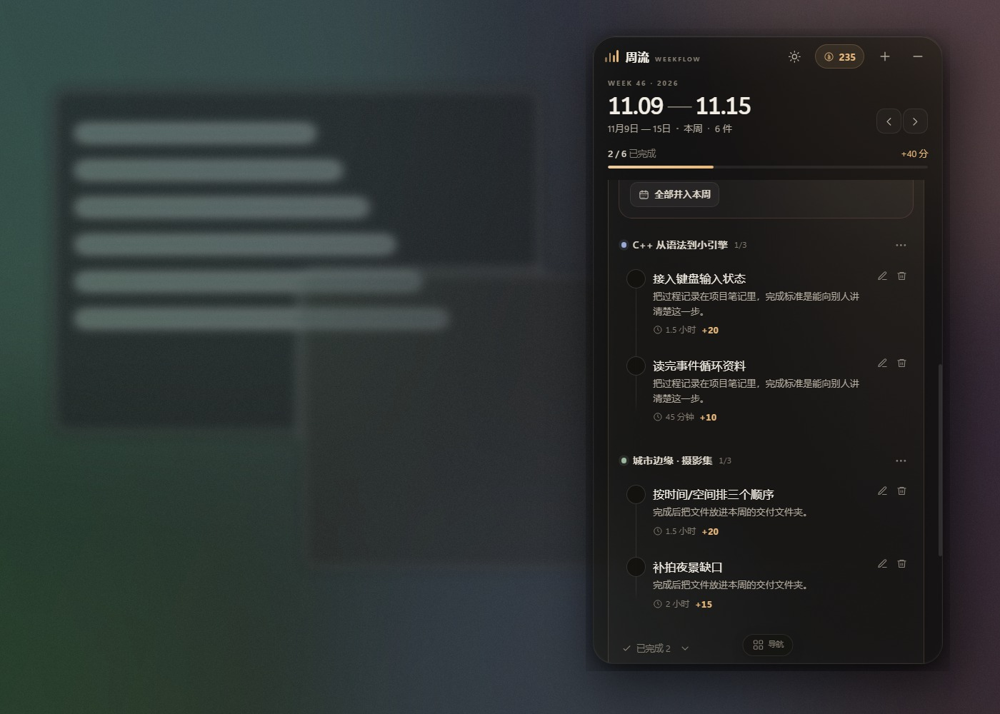

### 4.2 添加任务

顶部 `+` 或本周底部“给这一周加一件事”：

- 任务名、完成标准、归属项目、周次、积分、预计分钟。
- 归属项目选 **“＋ 新建项目…”**，或点下面的 **“＋ 新建”**，直接填项目名和周数；保存任务时一起创建项目。
- 勾选 **“每一周都要完成”**：会为项目剩余周生成同名任务；没有项目时生成未来 12 周。每周单独完成、单独计分。
- 建议：10 分≈随手小事，15 分≈常规任务，25–30 分≈一次硬仗。

### 4.3 逾期与周切换

- 周标题两侧箭头切换上一周/下一周；不在本周时出现“本周”按钮。
- 更早周未完成的任务会出现在“还欠着的”卡片，显示逾期几周。
- “全部并入本周”会把它们挪到当前周，并打上“补”标记；本周变重，未来周不变。
- 每周第一次打开时，如果上周有未完成项，会显示“新的一周”提示。

### 4.4 每日任务

每日任务和每周任务分开：它不属于某个项目，也不需要先排到某一周，**每天都会出现在本周页顶部**。

- 第一次打开时，每日区域会给出“锻炼 10 分 / 阅读 10 分 / 拉伸 5 分”的快捷按钮，点一下就会加入，不需要填表。
- 点右上角 `+` 或“自定义”可以自己起名、选图标、设每天积分（1–100 分）。
- 每天点一次左侧圆圈完成，加分；第二天的完成状态自动重置，但积分和连续天数保留。
- 标题下方的 7 个点表示最近 7 天，实心点是完成日，带圈的是今天；积分放在下一行，整条任务按纵向排列。
- 每日区域底部有“管理”按钮，打开后能看到所有每日任务并逐条编辑/删除；每条任务右上角也有**铅笔/垃圾桶**按钮。
- 删除会连同历史完成记录一起移除，可在提示里撤销。
- 如果每日任务赚的积分已经花掉，删除会被拒绝，避免积分变负。

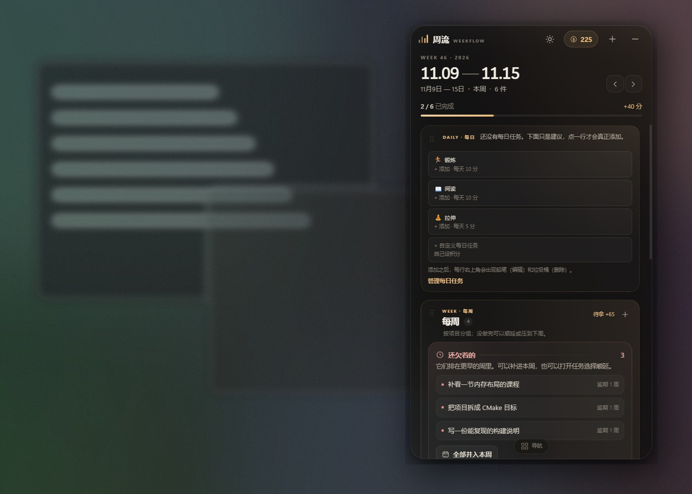

### 4.5 待办

这是独立于周计划的“高积分待办”：不绑定某个项目，也没有截止日期。适合“想学但不想排期”“早晚要做”的事情。

- 本周页有 **“待办”** 一栏。
- 点 `+` 或空卡片的“放一件早晚要做的事”新建：名称、说明、图标、积分（1–10000，建议 50–500）。
- 没有周次和截止时间；完成一次就加分，不能重复完成。
- 每条右上角有铅笔/垃圾桶，可编辑或删除；完成的也可以撤销完成。
- 删除已完成任务时，如果赚到的积分已经花掉，会被拒绝，避免负分。
- 积分进入同一本账，可在奖励页兑换或抽奖。

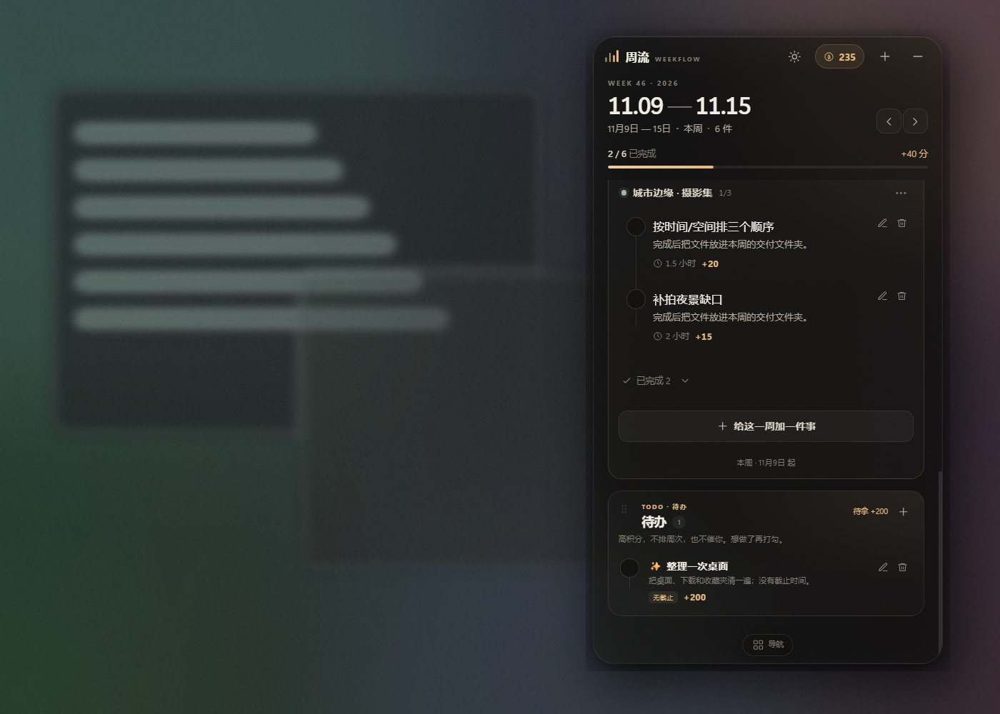

三个框左上角都有拖动把手（六个点），按住上下拖可以调整“每日 / 每周 / 待办”的顺序，松手后自动保存。

---

## 5. 单件任务与整个项目的推迟

打开具体任务 → 操作面板，默认只操作这一件任务：

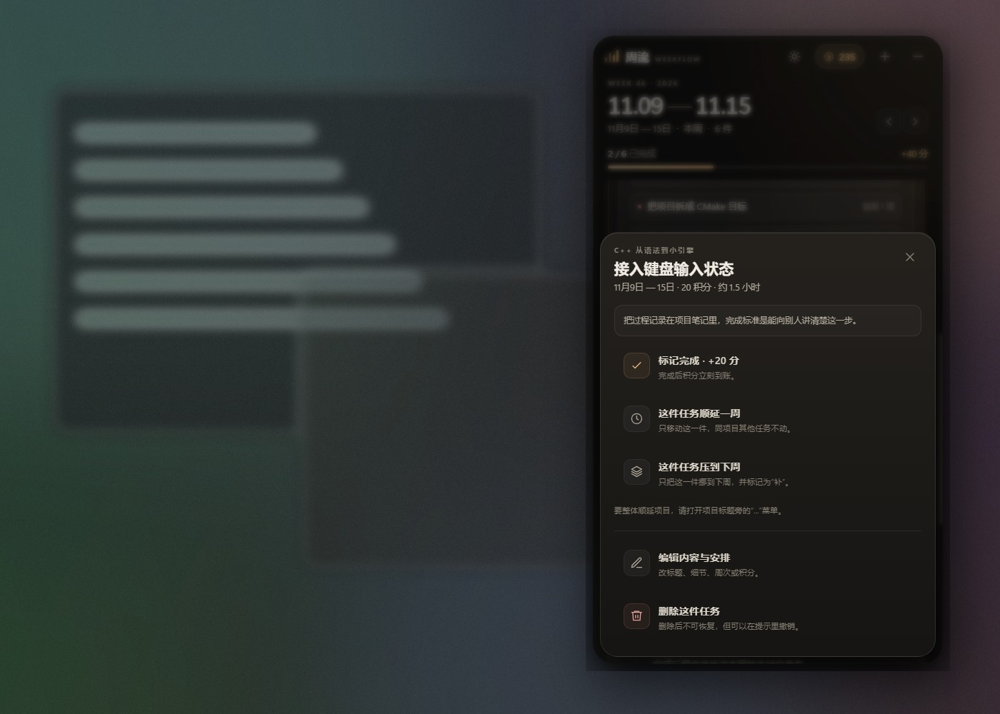

### 5.1 单件任务顺延一周

适合“这周这件先不做，其他任务照常”。

- 只把当前这一件任务后移 7 天。
- 同项目其他任务、未来周任务都不动。
- 已完成任务和积分不动。
- 项目顺延次数不增加。

### 5.2 单件任务压到下周

适合“这件这周没做完，下周补上”。

- 只把当前这一件任务挪到下一周，并标记“补”。
- 同项目其他任务不动。
- 下周会多出这一件，但不会把整个项目翻倍。

### 5.3 整个项目顺延

如果确实想调整整条项目节奏，打开项目标题旁的 `...` 菜单，选“整体顺延一周”：

- 该项目所有未完成任务后移 7 天。
- 已完成任务和积分不动。
- 项目记录“已顺延 N 次”。

### 5.4 撤销

单件任务和项目推迟都会弹出带“撤销”的提示，停留 6.5–7.5 秒。撤销恢复操作前的完整任务周次。

如果错过提示，可以再打开任务选相反操作，或直接编辑任务周次。

---

## 6. 积分、奖励、奖池

### 6.1 积分

- 完成任意任务：+任务积分，立即到账。
- **周末 / 节假日双倍**：周六日或“额外双倍日期”完成任务，积分 ×2；周任务、每日任务、待办都生效。
- 双倍在完成时写入流水，之后关闭开关不会追回；撤销完成会退回实际到账的分数。
- 撤销完成：退回积分；已花费时拒绝。
- 抽奖中奖：+奖金积分。
- 没有签到、连击或隐藏系数；“奖励 → 积分流水”逐条可查。

### 6.2 奖励

- 自己录入：名称、花费积分、emoji 图标、备注。
- 内置示例：奶茶 30、睡到自然醒 60、电影 80、游戏之夜 120、周末短途 400。
- 积分足够才能兑换；不足显示差多少。
- 每张奖励右侧有**铅笔（编辑）**和**垃圾桶（删除）**，不用先点开卡片。
- 兑换写一条负数流水，可在提示里撤销；删除奖励不影响历史记录。
- 兑换后记录会进入独立的 **“兑换”** 页面；实际用掉时点 **“核销”**，状态变“已核销”，也可以撤销核销。

### 6.3 奖池

花固定积分抽一次，按权重随机得到结果。内置“深空奖池”：

| 结果 | 概率 | 积分 |
| --- | ---: | ---: |
| 空手而归 | 65% | 0 |
| 回一点血 | 20% | 20 |
| 小小惊喜 | 9% | 80 |
| 今晚走运 | 4% | 300 |
| 深空回响 | 1.5% | 1500 |
| 传说级大奖 | 0.5% | 8888 |

每次 100 分；期望回报约 90.14 分，长期回报率约 90%。短期完全可能连续空手。

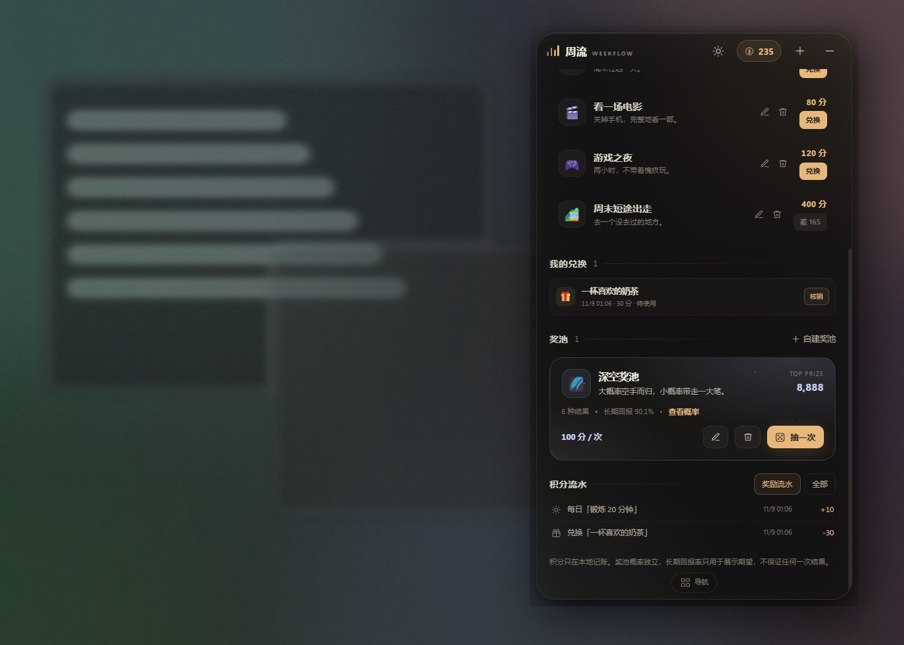

自建奖池可设置每次花费、结果名称、权重、积分和 **总奖品数 N**。权重支持整数或小数，不需要凑满 100，程序按总权重折算；例如 `65 / 20 / 9 / 4 / 2` 可以直接保存。N 会按权重分配成有限库存，足够大时每种结果至少 1 个，所以大奖即使概率低，抽完前也一定在库存里。

每个奖池会显示 **剩余 / 总数** 和库存条；抽一个少一个，抽完按钮会变成“已抽完”。点 **重置** 会恢复 N 个库存，并把该奖池的旧抽奖流水从列表隐藏；积分余额、任务积分和兑换记录都不变。

抽奖结果立即记账，不提供撤销。奖池是娱乐性的积分玩法，不涉及真实货币，也不是加密随机数。


### 6.4 兑换

底部导航和奖励页右上角的票据按钮都能进入 **“兑换”** 页。这里不再把兑换记录塞在奖励清单下面，而是一个独立页面：

- 顶部统计：待使用、已核销、累计花费积分。
- 按月份分组，显示每次兑换的**兑换时间**。
- 已核销的记录显示**核销时间**；未核销显示“尚未核销”。
- 可按“全部 / 待使用 / 已核销”筛选。
- 点“核销”标记已使用，点“撤销核销”恢复。
- 空状态会引导去奖励页兑换。

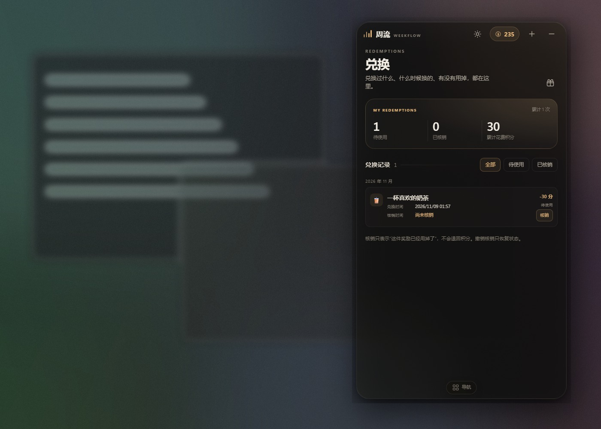

### 6.5 流水

奖励页底部的流水分成两个标签：

- **积分 / 兑换**：任务、每日、待办获得的积分，以及兑换扣分。
- **奖池**：抽奖的投入和回报。

每页显示 20 条，最多展示最近 200 条。重置某个奖池时，只隐藏该奖池的抽奖流水；积分和兑换流水不受影响，积分余额也不会被历史清理改变。

---

## 7. 设置与数据

### 7.1 桌面

| 设置 | 说明 |
| --- | --- |
| 窗口置顶 | 总在其他窗口之上 |
| 主题 | 墨夜 / 苔林 / 暮紫 / 米白，顶栏太阳按钮也能快速切换 |
| 自动淡出 | 默认关闭；需要时再开启 |
| 周末/节假日双倍 | 默认开启；周六日或额外日期完成任务 ×2 |
| 额外双倍日期 | 逗号分隔 YYYY-MM-DD，例如 2026-12-25 |
| 面板不透明度 | 45%–100%，默认 72%；顶栏滑杆可随时调 |
| 淡出程度 | 淡出后保留多少可见度，默认 50% |
| 强调色 | 5 种，影响积分、按钮、进度 |
| 减少动态效果 | 关闭大部分动画 |
| 桌面小条 | 收起/展开；显示每日第一个 + 每周前两个 |
| 鼠标穿透 | 点击落到桌面，快捷键/托盘恢复 |
| 开机自动启动 | 设置页“启动”区；随 Windows 登录启动，并与系统启动项同步 |

面板不透明度越低越“透明”，也越考验壁纸对比度。醒目壁纸建议调高一点。

### 7.2 数据位置

便携版在 `START_WEEKFLOW.cmd` 同级创建：

```
data\
  weekflow.json          全部项目、任务、积分、奖励、奖池
  weekflow.revision.json 修订号
  window-state.json      窗口位置
  backups\               每日备份，保留最近 21 份
```

换电脑时退出程序，把整个文件夹拷走。不要只拷 exe。

源码运行时数据在 `%APPDATA%\WeekFlow\`；也可以用环境变量 `WEEKFLOW_DATA_DIR=绝对路径` 指定。

### 7.3 备份与迁移

- `设置 → 数据 → 导出` 保存完整 JSON（含设置和 AI Key）。
- 导入会整体替换当前数据，建议先导出。
- 每次保存前会做当天首次备份；损坏 JSON 会被隔离为 `corrupt-*.json`。
- “载入示例”替换任务和积分，保留 AI 与外观；“清空数据”删除项目、每周任务、每日任务、积分、奖励与奖池，保留 AI 与外观。两者都有 8 秒撤销。

---

## 8. 常见问题

**双击没反应 / 没有托盘图标？**
确认解压到可写目录、没有被 SmartScreen 拦截。托盘图标可能被 Windows 折叠，点任务栏 `^` 展开；快捷键仍可唤出。

**快捷键没反应？**
可能被其他软件占用。程序依次尝试三个组合，以设置页显示为准；也可以单击托盘图标。

**开启穿透后点不到窗口？**
按设置页显示的快捷键，或右键托盘取消“鼠标穿透”。

**AI 提示连不上？**
本机模型：确认 Ollama / LM Studio 服务已启动，地址和端口正确。远程：检查网络、Key、余额。地址通常以 `/v1` 结尾，不是 `/v1/chat/completions`。

**AI 很慢或超时？**
本机模型首次加载较慢，等加载完再试；提示词太长也会慢。默认请求超时 180 秒。

**AI 计划很泛？**
换 7B 以上模型；目标里写清最终成果、每周时间、当前水平；生成后手动改。离线模板只是骨架。

**透明效果像纯黑？**
远程桌面、部分集显/旧驱动会退化透明合成。调低“面板不透明度”，或检查系统是否关闭了透明效果。窗口本身仍是透明无边框。

**积分会变负吗？**
正常操作不会。撤销完成前检查已花费积分；抽奖前检查余额。导入外部 JSON 可能带负余额，界面会用红色显示。

**周从周几开始？**
周一。日期按本机时区计算；跨时区换电脑后周次可能变化，但数据里的日期字符串不变。

**能多开吗？**
不能。单实例运行，第二次启动会唤出已有窗口。

**放在 OneDrive 会冲突吗？**
没有云同步。同步盘可能造成文件冲突，建议放本地，用导出/导入迁移。

---

## 9. 开发者

环境：Node.js 22+，Windows x64。

```powershell
npm install
npm start
npm test
npm run screenshot
npm run selftest
npm run dist
```

- 无前端构建步骤；改 CSS/JS 后重启 Electron 即可。
- 渲染进程 `nodeIntegration: false`、`contextIsolation: true`、`sandbox: true`；网络请求只在主进程发出。
- 保存使用临时文件 + rename，带 revision 冲突检测。
- 奖池使用 `Math.random`；真实抽奖场景应替换为加密随机源并做合规评估。

打包注意：如果终端设置了 `ELECTRON_RUN_AS_NODE=1`，Electron 会以 Node 模式运行并报 `app is undefined`。先执行：

```powershell
Remove-Item Env:ELECTRON_RUN_AS_NODE
```

---

## 10. 边界

- 初版只验收 Windows 10/11 x64；未做 macOS/Linux 安装包。
- 不读屏幕、不监听键盘、不访问通讯录；只有点击“生成计划/测试连接”时才向配置的 AI 地址发请求。
- API Key 明文保存在本机 JSON，导出备份会带出；共享电脑请用无 Key 的本机模型。
- 没有自动更新；升级时替换程序文件，保留 `data/`。
- 奖池每次独立随机，长期回报率不代表单次结果。

把这一周过好，比把一年排满更重要。
